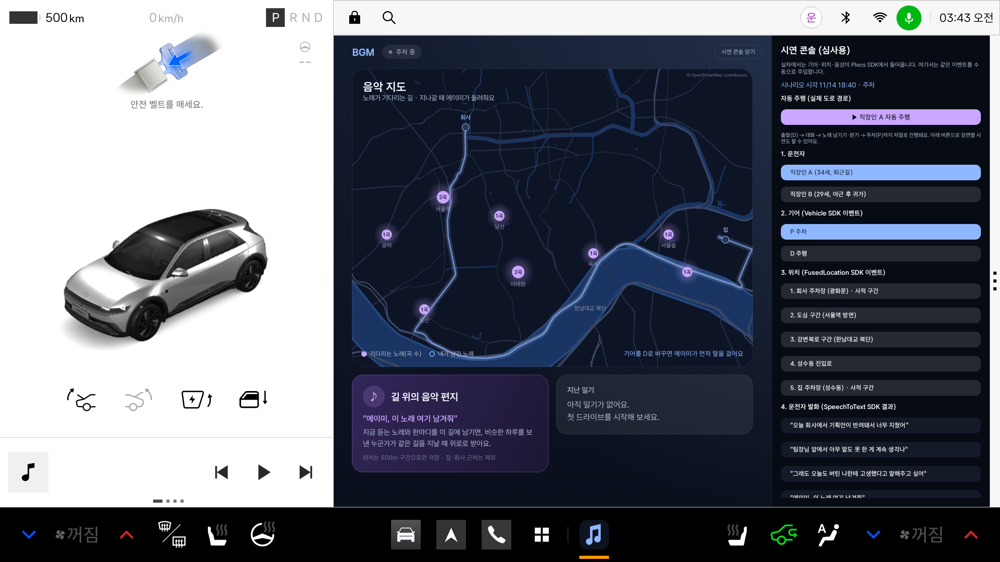
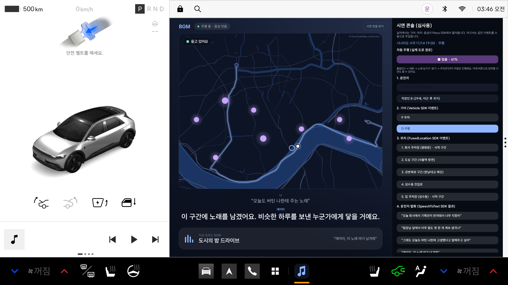
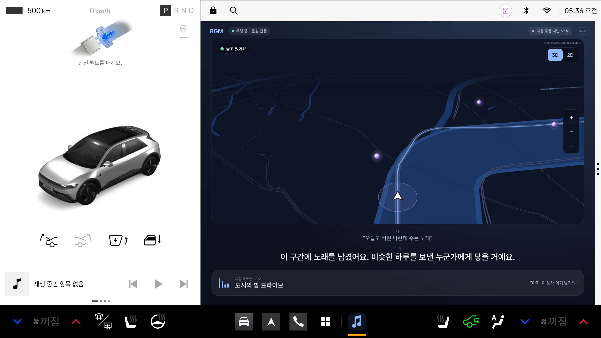
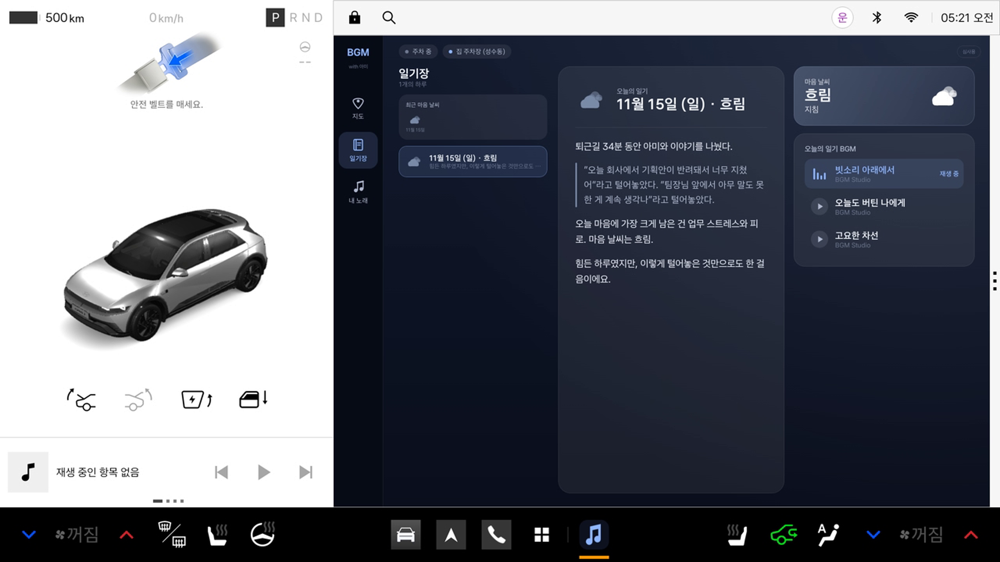
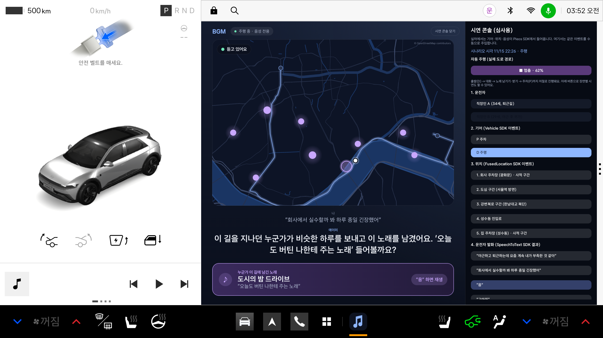
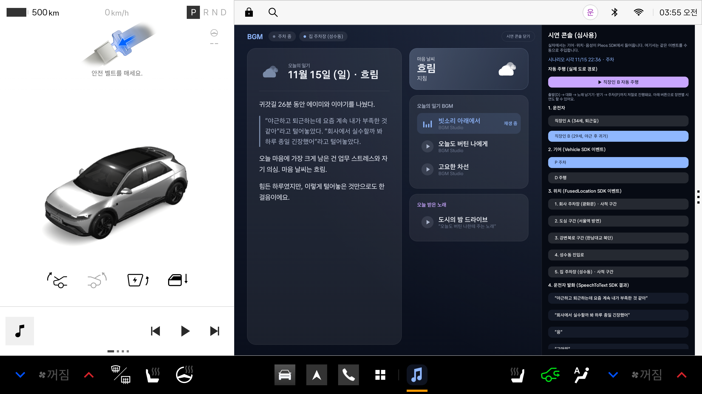

# BGM — 출퇴근길 차 안의 AI 감정 일기

> 출퇴근길 차 안에서 AI 동반자 **에이미**와 음성으로 하루를 털어놓으면, 주차할 때 일기와 그날의 배경음악(BGM)이 완성되고, 같은 길 위에서 비슷한 하루를 보낸 누군가와 노래로 위로를 주고받는 차량용 감정 일기 앱입니다.

현대자동차그룹 차량용 앱 개발 공모전 출품작 · Pleos Connect(Android Automotive OS) 네이티브 앱(Kotlin, Jetpack Compose)

---

## APK

| 항목 | 내용 |
|---|---|
| 파일 | [`apk/iAm_BGM_release.apk`](apk/iAm_BGM_release.apk) |
| 빌드 | release, 릴리스 키 서명 (v2), versionName 1.0.0 |
| 패키지 | `com.iam.bgm` · minSdk 28 · targetSdk 35 |
| SHA-256 | `1630614de6a314b907b0edde3377e9e329b3f6909238ee5045edf8dd0a548e63` |

## 개발·테스트 환경

| 항목 | 내용 |
|---|---|
| 에뮬레이터 | **Pleos Connect AVD 2.x** (`crp_car_emulator`, 빌드 `release_connect_v2.1.0`) |
| 시스템 이미지 | Android 14 (API 34), `pleos_car_emulator` x86_64 |
| 화면 규격 | **2560 × 1440, 160 dpi** (가로) · 앱 창은 홈 화면 멀티윈도우 영역에 표시 |
| 빌드 도구 | JDK 17, Android Gradle Plugin 8.8.2, Kotlin 2.0.0, compileSdk 35 |
| Pleos SDK | Vehicle 2.3.2 · SpeechToText 3.3.1 · TextToSpeech 3.3.1 · FusedLocation 1.1.3 · NaviHelper 3.0.5 |
| SDK 저장소 | `https://nexus-playground.pleos.ai/repository/maven-releases/` (settings.gradle.kts에 설정됨) |

## 실행 방법

### 1) APK로 바로 실행 (권장)

```bash
# Pleos Connect 에뮬레이터를 켠 뒤
adb install -r -g apk/iAm_BGM_release.apk
adb shell am start -n com.iam.bgm/.MainActivity
```

`-g`는 마이크(STT) 권한을 미리 허용합니다. 앱 서랍의 **BGM** 아이콘으로 실행해도 됩니다.

### 2) 소스에서 빌드

```bash
./gradlew :app:testDebugUnitTest   # 단위 테스트 (25개)
./gradlew :app:assembleRelease     # app/build/outputs/apk/release/app-release.apk
```

- `local.properties`에 `sdk.dir=<Android SDK 경로>`가 필요합니다.
- 릴리스 서명은 저장소 밖의 `keystore.properties`(storeFile, storePassword, keyAlias, keyPassword)를 읽습니다. 파일이 없으면 디버그 키로 서명되어 빌드는 항상 됩니다.

## 음악 지도

주차 중 첫 화면은 **음악 지도**입니다. OpenStreetMap의 실제 도로·한강·하천·공원 데이터(경로 일대, 단순화)를 앱이 직접 그리고, 그 위에 노래가 기다리는 구간이 보입니다. 지도 데이터는 APK에 들어 있어 네트워크·API 키 없이 동작합니다.

- **다른 사람의 노래는 곡 수만** 표시합니다. 어떤 노래인지는 비슷한 하루를 보낸 날 그 길을 지날 때 에이미가 음성으로 들려줍니다(노래를 '우연히 받는' 경험을 지키기 위해).
- **내가 남긴 노래**는 위치와 "닿았어요" 상태까지 표시하고, 구간을 누르면 상세 카드가 열립니다.
- **주행 중에는 '흘끗 보는 지도'**로 바뀝니다. 글자 없이 경로·내 위치·노래가 있는 구간의 빛나는 점만 그리며 터치를 받지 않습니다.
- 위치는 지도에서도 약 500m 구간 단위로만 다룹니다.
- 지도 데이터: `assets/osm_map.json`(도로·물길·공원, `tools/osm_build.py`로 Overpass 결과를 단순화해 생성), 지명은 `demo_scenario.json`의 `map`.
- 지도 데이터 © OpenStreetMap contributors, [ODbL 1.0](https://www.openstreetmap.org/copyright). 앱 지도 우측 상단에 출처를 표시합니다.



## 시연 방법 (시연 콘솔)

### 자동 주행 (권장)

시연 콘솔 맨 위의 **▶ 자동 주행**을 누르면, 차가 **실제 도로 경로**(광화문 → 세종대로 → 한강대로 → 강변북로 → 성수, 18.7km)를 따라 달리며 출발(D) → 대화 → 노래 남기기·받기 → 주차(P)가 저절로 진행됩니다(약 4~5분). 운전자 A로 한 번, 다음 날 B로 한 번 실행하면 시나리오 1·2가 끝납니다.

- 위치·기어·발화는 아래 수동 버튼과 같은 경로(FusedLocation·Vehicle·SpeechToText 이벤트 주입)로 들어가므로, 컨트롤러는 실차와 같은 흐름을 탑니다.
- 운전자 발화는 에이미가 말을 마친 뒤에 나오고, 노래 제안은 차가 그 구간에 **실제로 들어가는 순간** 일어납니다.
- 경로 데이터: `demo_scenario.json`의 `track`(OSRM으로 받은 OpenStreetMap 도로 경로를 단순화, `tools/track_build.py`), 사건 타임라인은 `autoDrive`.
- 실제 경로는 서울역·용산·옥수 등 다른 노래가 있는 구간을 지나므로, 엉뚱한 곳에서 제안되지 않는지 `AutoDriveTest`가 전체 주행을 돌려 검증합니다.

### 장면별 수동 시연

에뮬레이터에서는 실제로 차를 몰 수 없기 때문에, 앱 오른쪽의 **시연 콘솔(심사용)** 에서 Pleos SDK가 보내는 것과 같은 이벤트(기어·위치·음성 인식 결과)를 주입합니다. 콘솔 버튼은 SDK 콜백과 **같은 컨트롤러 메서드**를 호출하므로, 실차에서는 콘솔 없이 같은 흐름이 동작합니다. 에이미의 목소리는 실제 Pleos **TextToSpeech SDK(온디바이스)** 로 나옵니다.

**시나리오 1 — 퇴근길 직장인 A가 노래를 남긴다** ([영상](docs/demo/01_scenario_A_leave_song.mp4))
1. 운전자 `직장인 A` → 기어 `D 주행` : 화면이 음성 전용 모드로 바뀌고 에이미가 먼저 말을 겁니다.
2. 위치 `1. 회사 주차장` → 발화 1~3번 : 에이미가 짧게 공감·질문합니다.
3. 위치 `3. 강변북로 구간` → 발화 `"에이미, 이 노래 여기 남겨줘"` → `"오늘도 버틴 나한테 주는 노래"` : 지금 듣는 곡과 한마디가 이 구간에 저장됩니다.
4. 위치 `5. 집 주차장` → 기어 `P 주차` : 오늘의 일기, 마음 날씨, 위로 방향의 일기 BGM이 완성되고 자동 재생됩니다.

**시나리오 2 — 다음 날, 직장인 B가 노래를 받는다** ([영상](docs/demo/02_scenario_B_receive_song.mp4))
1. 운전자 `직장인 B`(다음 날로 이동) → `D 주행` → `1. 회사` → 발화 1~2번
2. `2. 도심 구간` : 다른 사람이 남긴 노래가 있지만 B의 오늘 감정과 결이 달라 **제안하지 않습니다.**
3. `3. 강변북로 구간` : A가 남긴 노래를 한마디와 함께 음성으로 제안합니다. → `"응"` 재생 → `"고마워"`
4. `5. 집` → `P 주차` : B의 일기에 "오늘 받은 노래"가 담깁니다.
5. 운전자 `직장인 A` → `D 주행` : 에이미가 "어제 남긴 노래가 누군가에게 닿았어요"라고 먼저 알려줍니다.

| 주행 중 (흘끗 보는 지도 + 음성) | 노래 남기기 | 주차 시 일기·BGM |
|---|---|---|
|  |  |  |

| 노래 받기 제안 | 받은 노래가 담긴 일기 |
|---|---|
|  |  |

## Pleos Connect SDK 사용

| SDK | 사용 API | 앱 기능 |
|---|---|---|
| Vehicle | 기어 상태 조회·구독, 앰비언트 라이트 색상 | P↔D 전환으로 주행 세션 시작/종료, 주차 시 감정 색 연출 |
| SpeechToText | 온디바이스 인식 `request/stop` | 운전 중 음성 대화, "남겨줘"·"응"·"고마워" 명령 |
| TextToSpeech | 온디바이스 합성 `speak` | 에이미 음성, 노래 제안 |
| FusedLocation | 위치 구독, 근접 알림(ProximityAlert ENTER) | 약 500m 구간 단위 노래 남기기·받기 |
| NaviHelper | 목적지 도착, 경로 종료 이벤트 | 목적지 도착 시 "주차하면 일기를 정리해 둘게요" 안내 |

에뮬레이터에서 지원하지 않는 기능(예: 앰비언트 라이트)은 화면에 미지원 안내를 표시하고 나머지 흐름은 그대로 진행합니다. 오른쪽 콘솔 하단 **SDK 연결 상태**에서 각 SDK의 연결 여부를 확인할 수 있습니다.

## 구조

```
app/src/main/java/com/iam/bgm/
├─ core/       순수 Kotlin 도메인 로직 (안드로이드·SDK 의존 없음, JVM 테스트 대상)
│   Logic.kt     주행 모드, 500m 구간화, 감정 분석, BGM 추천, 음성 의도, 한마디 검수, 편지 매칭, 말 걸기 게이트
│   Ami.kt       에이미 대화 정책(최대 2문장), 대화 → 일기 작성
├─ app/        상태 기계(BgmController)와 플랫폼 계약(Ports.kt)
├─ platform/   Pleos SDK 어댑터(PleosPorts.kt), 음원 재생·파일 저장·시나리오 시계
└─ ui/         Compose 화면(주행/주차/시연 콘솔)
app/src/main/assets/   감정 어휘·BGM 카탈로그·대화 문구·검수 정책·시연 시나리오 (수치·문구는 전부 데이터 파일)
tools/generate_tracks.py   데모 음원 합성기 (저작권 문제 없는 자체 합성, 시드 고정)
```

### 설계 원칙
- **운전 중 주의분산 최소화:** 주행 중에는 화면 조작을 받지 않고(`playFromParked`는 주차 상태에서만 동작) 글자 없는 지도와 음성만 사용합니다. 에이미 답변은 공감 1문장 + 질문 1문장입니다.
- **부정 감정을 증폭하지 않는 BGM:** 추천곡의 밝기(valence)는 항상 현재 감정 이상이며, 부정 감정이면 위로(comfort) 곡을 1순위로 둡니다.
- **위치 보호:** 좌표 대신 약 500m 격자 구간 id만 저장하고, 집·회사 인접 구간에서는 남기기를 막습니다.
- **콘텐츠 안전:** 한마디는 욕설·연락처·링크를 거절하고, 위기 신호가 있으면 공개하지 않고 도움 안내(109 등)를 표시합니다.
- **저작권:** 데모 음원은 직접 합성한 트랙입니다. 상용 버전은 곡 메타데이터만 저장하고 재생은 스트리밍 제휴 앱에 맡깁니다.

## 테스트

`./gradlew :app:testDebugUnitTest` — 25개 테스트, 앱이 실제로 쓰는 `assets` JSON을 그대로 읽어 검증합니다.

| 테스트 | 내용 |
|---|---|
| `CoreLogicTest` (12) | 기어→모드, 구간화, 부정 감정 BGM 원칙(모든 감정), 결정적 추천, 감정 분석, 음성 의도, 한마디 검수, 편지 매칭·만료·순위, 회전 구간 보류, 조사(와/과), 회귀: 주차 안내 조사(이에요/예요, 모든 날씨), 지도용 구간별 노래 수(내 것·받은 것·만료 제외) |
| `ScenarioTest` (6) | 기획서 시나리오 1·2 전체(남기기→주차 일기→받기→고마움→다음 운전 알림 1회), 집·회사 차단, 위기 한마디, 주행 중 터치 무시, 대화 없는 주차 |
| `LocationGateTest` (2) | 회귀: SDK 위치 갱신이 시연 콘솔로 옮긴 구간을 덮어쓰지 않음 |
| `AutoDriveTest` (2) | 실제 도로 경로로 자동 주행 전체(A→B): 노래 제안은 B의 강변북로에서 A의 노래 한 번뿐, 경로가 시나리오 지점을 모두 지남 |
| `VehicleGateTest` (2) | 회귀: 차량 서비스 재연결로 SDK가 다시 보낸 기어(P)가 시연 콘솔로 고른 주행(D)을 끝내지 않음 |
| `ClockMonotonicTest` (1) | 회귀: 작성 시각이 현재보다 늦은 편지는 매칭되지 않음 → 시연 시계는 단조 증가 |

## 알려진 한계 (데모 범위)
- 편지·일기 저장은 기기 내 파일입니다. 여러 차량 간 공유는 기존 ami 백엔드(FastAPI + Supabase/PostGIS·pgvector) 연동으로 교체할 예정이며, 교체 지점은 `StorePort` 계약입니다.
- 감정 분석은 온디바이스 어휘 사전 방식입니다. 서버 버전은 임베딩 분류기로 교체하되 `ThemeVector` 계약은 유지합니다.
- 일기 작성은 템플릿 기반입니다(LLM 요약은 서버 연동 시 적용).
- Vehicle SDK의 기어 조회 API가 deprecated 경고를 냅니다(SDK 안내: Google `GEAR_SELECTION` 속성 사용 권장). 동작에는 문제가 없으며 다음 버전에서 교체합니다.
- 복잡한 구간(다음 회전 300m 이내)에서 노래 제안을 미루는 게이트(`SpeechGate`)는 코어에 구현·테스트되어 있으나, NaviHelper에서 회전 거리를 받아오는 연결은 아직 없습니다. 길 안내 음성과 겹칠 때 대화를 멈추는 기능도 미구현입니다.
- 앱 음원 재생은 `MediaPlayer`를 직접 사용해 차량 클러스터의 미디어 위젯에는 곡 정보가 표시되지 않습니다(MediaSession 연동 예정).
